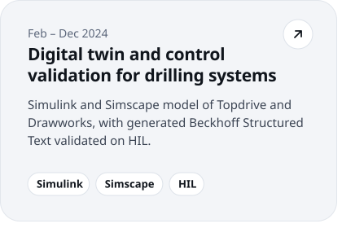
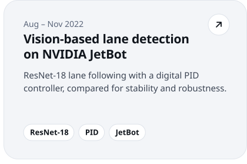
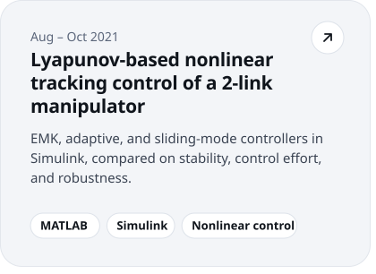
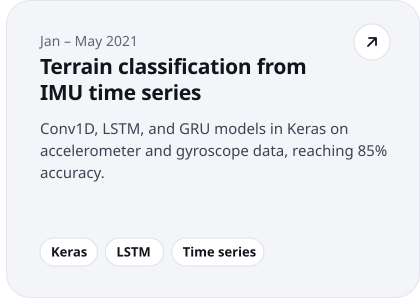
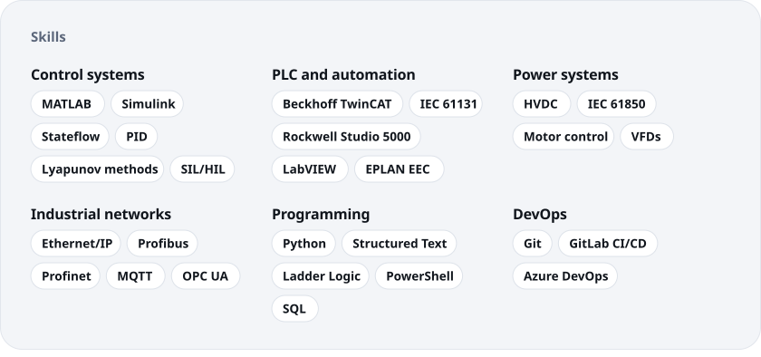

<!-- Generated by tools/gen.py. Edit the content there and re-run it; do not hand-edit the SVGs. -->

<picture><source media="(prefers-color-scheme: dark)" srcset="./assets/hero-dark.svg"></picture>
 
<a href="https://sahildeshp.github.io/"><picture><source media="(prefers-color-scheme: dark)" srcset="./assets/btn-website-dark.svg"></picture></a> <a href="https://sahildeshp.github.io/files/Resume%202025.pdf"><picture><source media="(prefers-color-scheme: dark)" srcset="./assets/btn-resume-dark.svg"></picture></a> <a href="https://www.linkedin.com/in/sahildeshpande/"><picture><source media="(prefers-color-scheme: dark)" srcset="./assets/btn-linkedin-dark.svg"></picture></a> <a href="mailto:sahil.dshp@gmail.com"><picture><source media="(prefers-color-scheme: dark)" srcset="./assets/btn-email-dark.svg"></picture></a>
 
<picture><source media="(prefers-color-scheme: dark)" srcset="./assets/role-dark.svg"></picture><picture><source media="(prefers-color-scheme: dark)" srcset="./assets/before-dark.svg"></picture>
 
<picture><source media="(prefers-color-scheme: dark)" srcset="./assets/hvdc-dark.svg"></picture>
 
<picture><source media="(prefers-color-scheme: dark)" srcset="./assets/projects-heading-dark.svg"></picture>
 
<a href="https://sahildeshp.github.io/#projects"><picture><source media="(prefers-color-scheme: dark)" srcset="./assets/project-digital-twin-dark.svg"></picture></a><a href="https://github.com/sahildeshp/Adaptive-Cruise-Control-and-Vision-based-Lane-Detection-of-NVIDIA-JetBot"><picture><source media="(prefers-color-scheme: dark)" srcset="./assets/project-jetbot-dark.svg"></picture></a>
 
<a href="https://github.com/sahildeshp/Lyapunov-based-Non-Linear-Tracking-Control-of-a-2-link-Robotic-Manipulator"><picture><source media="(prefers-color-scheme: dark)" srcset="./assets/project-lyapunov-dark.svg"></picture></a><a href="https://github.com/sahildeshp/Terrain_Classification_from_Time_Series_Data"><picture><source media="(prefers-color-scheme: dark)" srcset="./assets/project-terrain-dark.svg"></picture></a>
 
<picture><source media="(prefers-color-scheme: dark)" srcset="./assets/skills-dark.svg"></picture>
 
<a href="mailto:sahil.dshp@gmail.com"><picture><source media="(prefers-color-scheme: dark)" srcset="./assets/contact-dark.svg"></picture></a>

